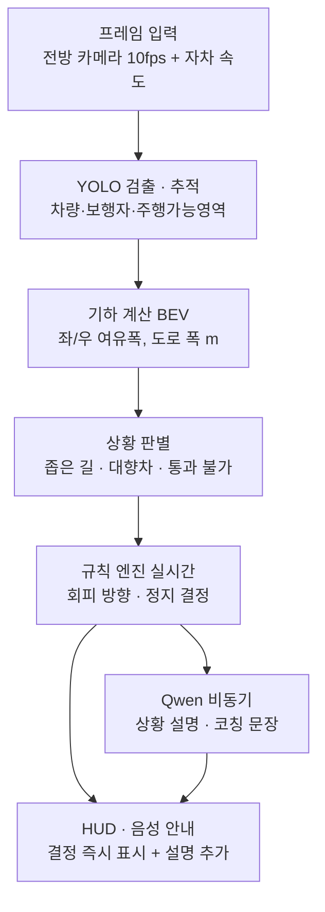

# 좁은 길 · 대향차 회피 판단 기능 — 처리 시퀀스

> 현대자동차그룹 차량용 앱 공모전(Pleos) · 초보 운전자 판단 보조 기능 설계안
> 작성일: 2026-11-13

---

## 0. 전체 흐름



---

## 1. 설계 원칙 (먼저 바꿀 점)

### 1-1. "어느 쪽이 가까운가"는 Qwen이 아니라 규칙으로 판단
- 좌우 여유폭 비교는 숫자 두 개의 비교 → 규칙으로 즉시 처리합니다.
- LLM에 맡기면 수백 ms~수 초 지연이 생기고, 같은 입력에도 답이 달라질 수 있습니다.
- 대향차는 2~4초 안에 다가오므로 **안전 판단은 규칙 엔진이 바로**, **Qwen은 설명·코칭 역할**을 맡깁니다.
- 심사 관점에서도 "결정은 결정론적 로직, 설명은 LLM" 구조가 더 설득력 있습니다.

### 1-2. 골목에는 차선이 거의 없음
- 실제 영상(`075433`, `075914`)에서 차선이 없거나 중앙선만 있습니다.
- 차선 검출 대신 **주행가능영역(free space) + 주차 차량 박스 안쪽 경계**를 좌우 경계로 씁니다.
- 차선은 있으면 보조 정보로만 씁니다.

---

## 2. 시퀀스 상세

### S0. 캘리브레이션 (1회)
- 자차 폭(예: 1.85m), 카메라 높이, 차량 중심선 대비 카메라 좌우 오프셋 입력
- 바닥 기준점 4개로 호모그래피(이미지 좌표 → 노면 좌표) 계산
  - 기준: 주차칸 선, 차선 폭 3.0~3.5m
- 광각 블랙박스이므로 **왜곡 보정 선행**

### S1. 입력 · 전처리
- 1080p 전방 채널(stream 0)을 10fps로 샘플링
- 보닛·하단 OSD 영역 마스크 처리
- 자차 속도: 현재는 OSD 값 사용, 실차에서는 Pleos 차량 데이터 사용 가정 (속도 API 제공 여부 확인 필요)

### S2. YOLO 검출 · 추적
- 모델: `yolo11n-seg` (또는 `yolov8-seg`)
- 클래스: car, truck, bus, person, motorcycle
- 주행가능영역: 기본 COCO 모델에 없음
  - BDD100K drivable area 학습 seg 모델 사용, 또는
  - 확보 영상에서 프레임 100~200장 라벨링 후 파인튜닝
- 추적: ByteTrack (ultralytics `model.track()` 내장)으로 객체 ID 부여

### S3. 객체 역할 분류 (트랙 단위)
| 역할 | 판별 기준 |
|---|---|
| 주차 차량 | 화면 측면 위치, 다가오는 속도 ≈ 자차 속도 (정지 물체) |
| 대향차 | 다가오는 속도 > 자차 속도 (뚜렷하게), 차 앞면·전조등 보이면 가중치 |
| 선행차 | 다가오는 속도 ≈ 0 또는 멀어짐 |

- 다가오는 속도 = BEV 상 전방거리 z의 변화율

### S4. 기하 계산 (BEV)
- 박스 하단 중심·하단 좌우 모서리를 노면 좌표(x: 좌우, z: 전방)로 변환
- 전방 3~15m 구간만 사용
- 경계 계산
  - `좌측경계 = max(좌측 주차차량 안쪽 모서리, 주행가능영역 좌측 끝)`
  - `우측경계 = min(우측 주차차량 안쪽 모서리, 주행가능영역 우측 끝)`
- 여유폭
  - `left_gap = (자차중심 - 자차폭/2) - 좌측경계`
  - `right_gap = 우측경계 - (자차중심 + 자차폭/2)`
  - `road_width = 우측경계 - 좌측경계`
- EMA로 0.5~1초 평활화

### S5. 상황 판별 (상태머신)
| 전이 | 조건 |
|---|---|
| `NORMAL → NARROW` | road_width < 자차폭×2 + 1.0m (약 4.7m) |
| `NARROW → ONCOMING` | 대향차 트랙 존재 + TTC < 4초 |
| `ONCOMING → BLOCKED` | road_width < 자차폭 + 대향차폭(1.8m 가정) + 안전여유 0.6m |

- 진입/해제 임계값을 다르게 두어 상태 깜빡임 방지 (히스테리시스)

### S6. 규칙 엔진 (결정)
- **NARROW만**: 여유가 더 작은 쪽 경고 (예: "왼쪽 주차차량 35cm")
- **ONCOMING + 통과 가능**: 우측통행 기본 → 오른쪽으로 붙음
  - 이동 가능 거리 = `right_gap - 0.3m`
  - 부족하면 "감속 후 정지, 대향차 먼저 통과"
- **BLOCKED**: "정지"
  - 전방 근처에 우측이 넓어지는 구간(빈 주차칸, 골목 입구)이 있으면 "그 앞에서 대기"
- 후진 유도는 초보자에게 위험하므로 제외

### S7. Qwen (비동기, 상태 변화 시에만 호출)
**입력** — 원본 영상이 아닌 정리된 JSON:
```json
{
  "state": "ONCOMING",
  "speed_kmh": 14,
  "left_gap_m": 0.35,
  "right_gap_m": 0.9,
  "road_width_m": 4.1,
  "oncoming": {"type": "truck", "dist_m": 12, "ttc_s": 2.8},
  "pedestrian_near": true,
  "decision": "MOVE_RIGHT_THEN_STOP",
  "shift_m": 0.6
}
```

**출력** — 1~2문장 한국어 안내:
> "앞에서 트럭이 와요. 오른쪽으로 60cm 붙어서 멈추고 먼저 보내세요. 왼쪽 주차차량이 가까워요."

- 프롬프트에 **"decision 필드를 바꾸지 말 것"** 명시
- 타임아웃 1.5초 초과 시 템플릿 문장으로 대체
- 모델: Qwen2.5-3B / 7B-Instruct 충분
- (선택) Qwen-VL로 장면 유형(골목/양측주차)을 2초마다 교차 확인

### S8. 출력
- 규칙 결정 **즉시 표시**: 회피 화살표, 좌우 여유 바, 경고음
- Qwen 문장은 도착하는 대로 TTS로 추가
- 프레임별 JSON 로그 저장 → 검증용

---

## 3. 핵심 로직 의사코드

```python
EGO_W, ONC_W, MARGIN = 1.85, 1.8, 0.6

def decide(s):  # s: 평활화된 상태값
    need = EGO_W + ONC_W + MARGIN
    if s.state == "NARROW":
        side = "LEFT" if s.left_gap < s.right_gap else "RIGHT"
        return Warn(side, min(s.left_gap, s.right_gap))
    if s.state in ("ONCOMING", "BLOCKED"):
        if s.road_width >= need and s.right_gap - 0.3 >= REQUIRED_SHIFT:
            return MoveRight(shift=s.right_gap - 0.3, then="SLOW")
        return Stop(wait_spot=find_wider_spot_ahead(s))  # 없으면 현 위치 정지
    return Normal()
```

---

## 4. 검증용 구간 (normal 폴더 · 기대 정답)

| 파일 | 구간 | 상황 | 기대 결과 |
|---|---|---|---|
| `REC2_20261110_075433` | 28~34초 | 대향 승용차 + 탑차 | 오른쪽 이동 불가 → **정지 후 양보** |
| `REC2_20261110_075433` | 40~43초 | 양쪽 주차, 대향 트럭 | **BLOCKED** |
| `REC2_20261112_075914` | 20~22초 | 양쪽 주차, 대향 SUV | **정지 또는 우측 대기** |
| `REC2_20261112_082241` | 4~28초 | 양쪽 주차만 | **NARROW 경고만** (회피 안내 없어야 함) |

### 보조 구간
| 파일 | 구간 | 상황 |
|---|---|---|
| `REC2_20261110_075346` | 10~43초 | 벽 + 주차 차량 사이 좁은 길 (정차 대기) |
| `REC2_20261110_075433` | 0~28초 | 좁은 길 서행 진입 |
| `REC2_20261110_075517` | 0~4초 | 양쪽 주차 골목 → 큰길 진입 |
| `REC2_20261110_082524` | 6~28초 | 한쪽 주차 + 정면 보행자 (역광) |
| `REC2_20261112_082325` | 28~40초 | 벽 + 한쪽 주차열 사이 좁은 도로 |

---

## 5. 마감(11/15) 기준 구현 범위

- Pleos 실차 실시간 구동은 2일 내 어려움
- **현실적 데모 구성**
  1. PC에서 위 클립에 파이프라인을 오프라인으로 실행
  2. BEV 여유폭 · 상태 · 결정 · Qwen 문장을 영상 위에 오버레이 → **목업 영상**
  3. APK는 결과 JSON을 재생하는 **HUD 화면**만 구현
