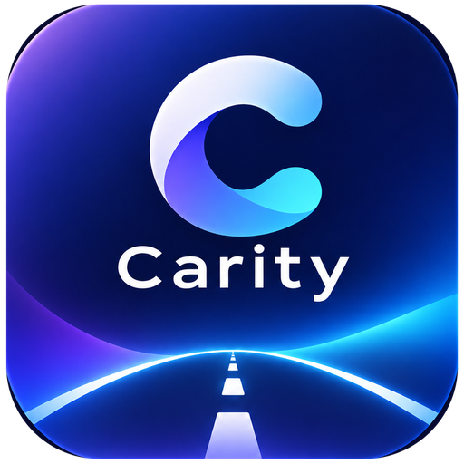

<p align="center"></p>

# Carity — 좁은 길 통과 보조

 

초보 운전자가 **좁은 골목, 양쪽 주차 구간, 좁은 길 대향차** 상황을 지나갈 수 있도록
남은 간격과 지나갈 길을 계산하고 **음성과 화면으로 안내**하는 Pleos 차량용 앱입니다.
현대자동차그룹 차량용 앱 개발 공모전 출품작입니다.

> 기능, 판단 규칙, 검증 결과는 **[Carity.md](Carity.md)**(기술서)에 있습니다.

---

## 무엇을 하나요

에뮬레이터 앱 목록에 아이콘 3개가 생깁니다.

| 앱 | 하는 일 |
|---|---|
| **Carity 시뮬레이션** | 3D 골목에서 차체와 장애물 사이 간격을 계산해 경고하고, 실내 조명으로 위험 방향을 보여 줍니다. **[라벨 장애물·AI 판단]** 탭에서는 실제 블랙박스 라벨로 만든 장면을 불러와 판단하고 음성으로 안내합니다. |
| **Carity 튜토리얼** | 상황 설명 → AI 판단 → 노면 화살표 → 차가 먼저 지나가는 미리 보기 → 따라 주행 순서로 연습합니다. |
| **Carity 라벨 뷰어** | PC에 있는 블랙박스 영상을 태블릿에서 보고, 라벨이 없으면 PC에서 YOLO로 라벨링합니다. |

## 작동 방식

```
블랙박스 영상 ──YOLO 라벨링(PC 서버)──► 차량·보행자 위치
   ──► 도로 위 장애물로 변환 · 좌우 간격 계산
   ──► 경로 계획 (지나감 / 양보 / 정차)
   ──► 규칙 엔진이 행동 결정 ──► AI(Qwen 또는 Claude)가 안내 문장 다듬기
   ──► 음성 안내 + 화면 표시
```

- **결정은 규칙 엔진**이 바로 내립니다. AI는 문장만 다듬고, 더 위험한 행동을 말하면 무시합니다.
- AI는 `.env`에 Claude 키가 있으면 Claude, 없으면 PC의 **Qwen**(Ollama, `qwen2.5:3b`)을 씁니다.
- 음성은 **Pleos TTS → Android TTS → PC 음성(Windows 한국어)** 순서로 되는 것을 씁니다.

---

## 처음 설치하는 PC에서 실행하기

처음 한 번은 1~6단계를 모두 하고, 그다음부터는 [매번 실행하기](#매번-실행하기)만 하면 됩니다.

### 1. 준비물 설치

| 항목 | 설치 방법 / 확인 |
|---|---|
| Windows 10 또는 11 | PowerShell 5 이상 (기본 포함) |
| Android Studio | 설치 후 한 번 실행해 Android SDK를 기본 위치(`%LOCALAPPDATA%\Android\Sdk`)에 받습니다. JDK는 Android Studio에 들어 있는 것을 씁니다. |
| Pleos Connect 에뮬레이터 | Pleos 개발자 안내에 따라 Android Studio **Device Manager**에 Pleos Connect AVD를 추가합니다. AVD 이름에 `Pleos`가 들어가면 자동으로 찾습니다. |
| Python 3.10 이상 | [python.org](https://www.python.org/)에서 설치할 때 **Add python.exe to PATH**를 체크합니다. 라벨링 서버용입니다. |
| 인터넷 연결 | 처음 설치 때 Gradle 라이브러리, PyTorch(약 5 GB), Ollama와 Qwen 모델(약 1.9 GB)을 받습니다. |
| 디스크 여유 | 약 15 GB |

NVIDIA 그래픽카드가 있으면 라벨링 서버가 GPU(YOLO11s)를 쓰고, 없으면 CPU(YOLOv8n)를 씁니다. 둘 다 동작합니다.

### 2. 소스 받기

팀 GitHub 저장소를 받거나(`git clone`), 공유받은 `Carity_ver2` 폴더를 원하는 위치에 복사합니다.
아래 설명에서는 이 폴더를 **Carity 폴더**라고 부릅니다.

> 경로에 한글이나 공백이 있어도 됩니다. 다만 폴더를 다른 프로그램이 열고 있는 동안에는 이름을 바꾸지 마세요(문제 해결 표 참고).

### 3. 블랙박스 영상 폴더 정하기

라벨링 서버가 보여 줄 영상 폴더가 필요합니다. 둘 중 하나를 고릅니다.

- **기존 폴더를 그대로 쓰기**: 4단계에서 `.env`의 `DATA_ROOT`를 그 폴더로 바꿉니다.
- **Carity 폴더 안에 넣기**: 영상과 라벨을 `Carity 폴더\data`에 복사하고 `DATA_ROOT=data`로 둡니다.

앱 안에 검증용 라벨 장면 6개가 들어 있어서, 영상 폴더가 없어도 시뮬레이션과 튜토리얼은 동작합니다.

### 4. 설정 파일 `.env` 확인

1. Carity 폴더의 `Carity.bat`를 한 번 더블클릭했다가 `0`(나가기)을 누르면 `.env`가 자동으로 생깁니다. 직접 `.env.example`을 복사해 `.env`로 이름을 바꿔도 됩니다.
2. `.env`를 메모장으로 열고 아래 두 줄을 이 PC에 맞게 고칩니다.

```ini
DATA_ROOT=D:\내\영상\폴더          # 3단계에서 정한 폴더
LEGACY_SERVER=                     # 이미 설치된 라벨링 서버 폴더가 없으면 비워 둡니다
```

나머지 설정은 [설정 표](#설정-env)를 보세요. Claude를 쓰려면 `ANTHROPIC_API_KEY`에 키를 넣습니다. 비워 두면 Qwen을 씁니다.

### 5. 처음 설치 — `Carity.bat` → **2**

`Carity.bat`를 더블클릭하고 **2) 처음 설치**를 고릅니다.

1. 라벨링 서버의 Python 환경을 만듭니다. `LEGACY_SERVER`에 기존 환경이 있으면 그대로 쓰고, 없으면 PyTorch(CUDA 12.8)와 필요한 패키지를 설치합니다. 10분 이상 걸릴 수 있습니다.
2. Ollama를 설치하고 `qwen2.5:3b` 모델을 받습니다.
3. 마지막에 상태 점검 결과가 나옵니다. `!!` 표시가 있으면 [문제 해결](#문제-해결)을 보세요.

### 6. 앱 빌드와 첫 실행 — `Carity.bat` → **1**

**1) 전체 시작**을 고릅니다. 처음에는 앱이 설치되어 있지 않아 자동으로 빌드합니다(5~10분).

1. Ollama를 켜고 Qwen 모델을 메모리에 미리 올립니다.
2. 라벨링 서버를 켭니다. **"Carity labeling_server"라는 새 창**이 열립니다. 이 창을 닫으면 서버도 꺼집니다.
3. Pleos 에뮬레이터를 켭니다(이미 켜져 있으면 그대로 씁니다).
4. 두 앱을 빌드해서 에뮬레이터에 설치합니다.
5. 앱 권한을 미리 허용하고, 화면을 가리는 창이 없는지 확인합니다.

`OK`가 이어지고 마지막에 `상태`가 나오면 준비가 끝난 것입니다.

---

## 매번 실행하기

1. `Carity.bat` → **1) 전체 시작**
2. 에뮬레이터 하단 **앱 목록**에서 앱을 엽니다.

| 앱 | 사용 순서 |
|---|---|
| Carity 시뮬레이션 | 오른쪽 패널 **[라벨 장애물·AI 판단]** 탭 → **장면 선택** → **3D 자동 시연**. 판단 결과와 AI 문장이 패널에 나오고 음성으로 읽어 줍니다. |
| Carity 튜토리얼 | **장면 선택** → 6단계가 자동으로 진행됩니다. 일시정지, 다음 단계, 음성 켬/끔 버튼이 있습니다. |
| Carity 라벨 뷰어 | 서버 주소 `http://10.0.2.2:8765` 확인 → **연결** → 폴더와 영상 선택. 라벨이 없는 영상은 PC에서 라벨링한 뒤 재생합니다. |

3. 끝낼 때는 서버 창과 에뮬레이터를 닫습니다. Carity 폴더 이름을 바꾸거나 옮길 계획이면 먼저 `Carity.bat` → **8) 전체 종료**를 합니다.

---

## 메뉴 전체

| 메뉴 | 명령 | 설명 |
|---|---|---|
| 1 | `Carity.bat start` | 전체 시작 |
| 2 | `Carity.bat setup` | 처음 설치 |
| 3 | `Carity.bat build` | 앱 2개 다시 빌드·설치 (코드나 `.env`의 AI 키를 바꾼 뒤) |
| 4 | `Carity.bat server` | 라벨링 서버만 실행 |
| 5 | `Carity.bat status` | 서버, Ollama, 에뮬레이터, 앱 설치, 현재 화면 점검 |
| 6 | `Carity.bat logs` | 앱 로그를 `logs\`에 저장 |
| 7 | `Carity.bat copydata` | 영상·라벨을 `data\`로 복사 |
| 8 | `Carity.bat stopall` | 서버·빌드 데몬·adb 등 Carity 폴더를 잡고 있는 프로그램 종료 |
| 9 | `Carity.bat diag` | 에뮬레이터 → PC 네트워크 진단 |
| 10 | `Carity.bat reset` | 에뮬레이터를 처음 상태로 다시 부팅하고 앱을 최신 빌드로 재설치 |
| — | `Carity.bat stop` | 라벨링 서버만 종료 |

실행 기록은 `logs\carity.log`에 남습니다.

---

## 설정 (`.env`)

| 키 | 기본값 | 설명 |
|---|---|---|
| `ANTHROPIC_API_KEY` | (비움) | 넣으면 Claude 사용, 비우면 Qwen. **바꾼 뒤 메뉴 3(build) 필요** |
| `CLAUDE_MODEL` | `claude-haiku-5-5` | Claude 모델 |
| `QWEN_MODEL` | `qwen2.5:3b` | Ollama 모델 |
| `QWEN_BASE_URL` | `http://10.0.2.2:11434` | 앱에서 본 Ollama 주소 |
| `DATA_ROOT` | `D:\02. SSAFY\Hyundai Test` | 영상·라벨 폴더. 상대경로(`data`)는 Carity 폴더 기준 |
| `SERVER_PORT` | `8765` | 라벨링 서버 포트 |
| `SERVER_ARGS` | (비움) | 예: `--force-cpu` |
| `LABEL_SERVER_URL` | `http://10.0.2.2:8765` | 앱에서 본 라벨링 서버 주소 |
| `LEGACY_SERVER` | `D:\02. SSAFY\Hyundai Test\labeling_server` | 이미 설치된 서버 Python 환경 위치. 있으면 그대로 사용 |
| `EMULATOR_AVD` | (비움) | 비우면 이름에 Pleos가 들어간 AVD 자동 선택 |
| `EMULATOR_COLD_BOOT` | `false` | `true`면 항상 처음 상태로 부팅 |
| `BUILD_ON_START` | `false` | `true`면 시작할 때마다 앱을 다시 빌드 |
| `ANDROID_SDK` | (비움) | 비우면 `%LOCALAPPDATA%\Android\Sdk` |

> `.env`는 git에 올리지 마세요. API 키는 빌드된 APK 안에 들어가므로 외부 배포용 빌드에는 넣지 않습니다.

---

## 문제 해결

| 증상 | 해결 |
|---|---|
| 앱 버튼을 눌러도 반응이 없음 | `Carity.bat` → **10) 에뮬레이터 초기화**. 에뮬레이터를 처음 상태로 다시 켜고 앱을 다시 설치합니다. |
| Carity 시뮬레이션을 눌러도 화면이 안 뜸 | 메뉴 1로 다시 시작합니다(권한을 미리 허용해 보이지 않는 권한 창을 막습니다). |
| 폴더 이름 변경·삭제가 "다른 프로그램에서 사용 중"으로 안 됨 | 메뉴 **8**, Android Studio에서 File > Close Project, 서버 창과 `Carity.bat` 창 닫기 순서로 진행합니다. |
| 라벨 탭에서 "PC 라벨 서버 연결 실패" | 메뉴 5로 서버 확인. 꺼져 있으면 메뉴 4. 그래도 안 되면 메뉴 9 |
| 라벨 뷰어 연결 실패 | 서버 주소가 `http://10.0.2.2:8765`인지 확인, 메뉴 9 |
| "영상 라벨링 데이터가 없음" | `.env`의 `DATA_ROOT`가 실제 영상 폴더인지 확인. 메뉴 5에 영상·라벨 개수가 나옵니다. |
| AI 판단이 "연결 실패 → 규칙 엔진 문장 사용" | Ollama가 꺼져 있거나 첫 응답이 느린 경우입니다. 메뉴 5로 확인합니다. 규칙 판단은 정상 동작합니다. |
| 소리가 안 남 | 화면의 "음성:" 줄 확인. PC 음성을 쓰려면 라벨링 서버가 켜져 있어야 합니다. PC 볼륨도 확인합니다. |
| "서버 Python 환경 없음" | 메뉴 2(처음 설치) |
| 빌드 실패 | Android Studio로 `android` 폴더를 열어 Gradle Sync 오류를 확인합니다. |
| 에뮬레이터가 켜졌다가 바로 꺼짐 | 메뉴 10. 계속되면 메뉴 6으로 로그를 저장해 팀에 공유합니다. |

---

## 폴더 구조

```
Carity 폴더/
├─ README.md            이 파일 (소개·설치·실행)
├─ Carity.md            기술서 (기능·구현·판단 규칙·검증)
├─ Carity.bat           실행기 (더블클릭)
├─ carity.ps1           실행기 본체
├─ .env.example         설정 예시 (.env 로 복사해 사용)
├─ android/             Android Studio 프로젝트 (이 폴더를 열면 됨)
│  ├─ app/              Carity 시뮬레이션 + Carity 튜토리얼
│  └─ viewer/           Carity 라벨 뷰어
├─ server/labeling_server/   라벨링 서버 (YOLO, PC 음성)
├─ tools/               보조 스크립트
├─ docs/                아이콘, 통합 전 원본 문서(docs/원본)
├─ data/                (선택) 영상·라벨
└─ logs/                실행·앱 로그
```

## 개발자용

```powershell
cd android
.\gradlew.bat :app:assembleDebug :viewer:assembleDebug   # Android Studio 없이 빌드
.\gradlew.bat :app:testDebugUnitTest                      # 단위 테스트
```

- 에뮬레이터에서 PC 주소는 `10.0.2.2`입니다 (서버 `:8765`, Ollama `:11434`).
- 앱 로그 태그: `CarityVoice`(음성), `CarityAI`(AI 판단), `CarityLabel`(라벨 장면), `CarityVehicle`(차량 데이터). 전체 목록은 Carity.md 15-4절.
- 패키지 이름은 `com.example.pleostest`(시뮬레이션·튜토리얼), `com.guardians.viewer`(라벨 뷰어)입니다.

## 버전 기록

| 버전 | 날짜 | 내용 |
|---|---|---|
| 2.0.0 | 2026-11-15 | 이름을 Carity로 통일, Carity 아이콘, 기술서 통합, 실행기 메뉴 8·9·10, 서버 환경 재사용, Qwen 응답 대기 개선 |
| 1.0.0 | 2026-11-14 | Carity ver1 통합: 시뮬레이션 + 라벨 장애물·AI 판단 + 음성 + 튜토리얼 + 라벨 뷰어 + 라벨링 서버 + 통합 실행기 |

버전 규칙: `주.부.수` (주: 구조·판단 규칙 변경 / 부: 기능 추가 / 수: 수정·문서). 자세한 이력은 [Carity.md 14장](Carity.md#14-변경-이력)을 보세요.
